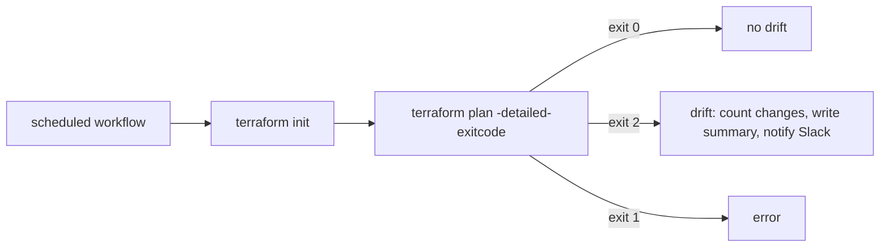

# Scheduled Terraform drift detection

Infrastructure sometimes changes outside of Terraform — a manual console edit, a hotfix applied
by hand, an expired resource recreated differently. Terraform's own state only catches this the
next time someone runs `plan` or `apply`. Nobody checks until something breaks.

This repo runs `terraform plan` on a schedule and reports if the live state has drifted from the
code.

## Flow



On drift, the create/update/delete/replace counts come from `terraform show -json` on the plan,
not from parsing plan text.

## Exit codes

| code | meaning |
|------|---------|
| 0 | no drift |
| 1 | terraform error (bad config, init/plan failure) |
| 2 | drift found |

## Setup

Add a `SLACK_WEBHOOK_URL` repository secret to get a Slack message when drift is found. Leave it
unset to skip the Slack step entirely — drift is still reported in the job summary either way.

## Status

Tested with shellcheck and local terraform_data tests, including a forced replacement. Real cloud
drift and an actual Slack post are not yet tested. A failed Slack post only logs a warning - it
never changes the script's exit code.

## State

No state file is committed. The sample config only uses `terraform_data`, so state can be created
locally in seconds without any cloud account:

- `test/run.sh` copies `config/main.tf` into a temp dir for each case and runs `terraform apply`
  there first, then edits the config to simulate drift.
- The scheduled workflow runs `terraform apply` on `config/` before the drift check, so a clean
  run reports "no drift".

To try it locally:

```sh
terraform -chdir=config init
terraform -chdir=config apply -auto-approve
bash scripts/drift.sh config   # exit 0, no drift
```

Run the same checks as CI (needs Terraform, jq and shellcheck; no cloud account):

```sh
shellcheck scripts/drift.sh test/run.sh
bash test/run.sh
```

Real use needs a remote backend (for example S3 with locking) that holds the state, and the
"create demo state" step in `.github/workflows/drift.yml` should be removed.

## Known limitations

The sample config only simulates drift, by changing the config against saved state. Real cloud
drift needs credentials and a real backend, which this repo does not use. The Slack post is not
tested end to end. Infracost cost estimates are not included.
