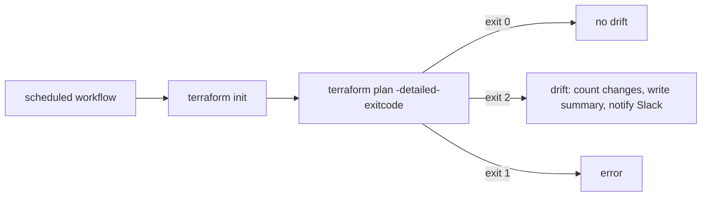

# Terraform drift detection

Infrastructure sometimes changes outside of Terraform — a manual console edit, a hotfix applied
by hand, an expired resource recreated differently. Terraform's own state only catches this the
next time someone runs `plan` or `apply`. Nobody checks until something breaks.

This repo runs `terraform plan` on a schedule and reports if the live state has drifted from the
code.

## Flow

## Exit codes

| code | meaning |
|------|---------|
| 0 | no drift |
| 1 | terraform error (bad config, init/plan failure) |
| 2 | drift found |

## Setup

Add a `SLACK_WEBHOOK_URL` repository secret to get a Slack message when drift is found. Leave it
unset to skip the Slack step entirely — drift is still reported in the job summary either way.

## Status

Tested with shellcheck and a local terraform_data test only. Real cloud drift and the Slack post
are not yet tested.

## Limits

The sample config only simulates drift, by changing the config against saved state. Real cloud
drift needs credentials and a real backend, which this repo does not use. The Slack post is not
tested end to end. Infracost cost estimates are not included.
